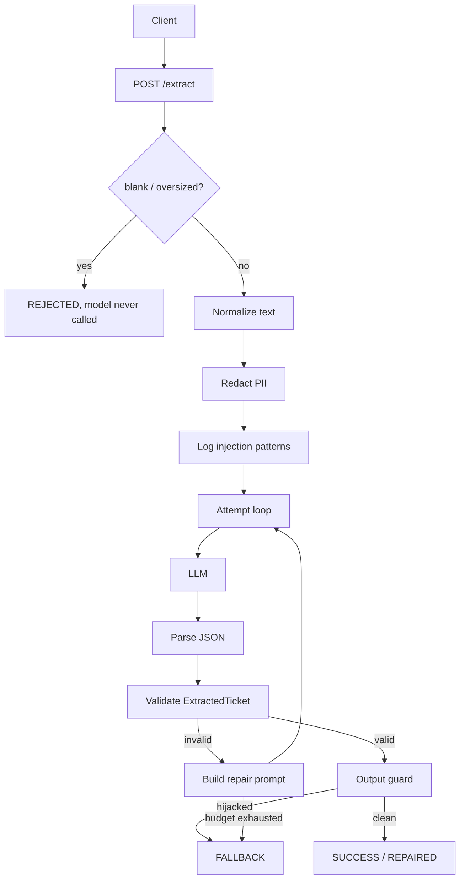
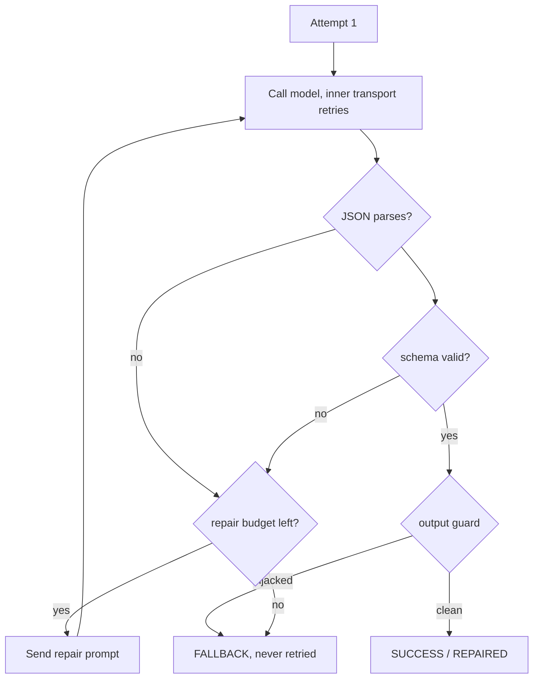
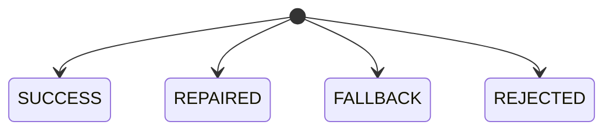
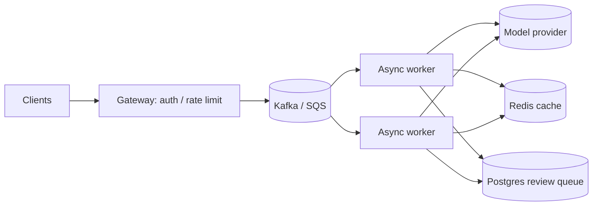

<div align="right">
  <a href="README_zh.md">🇨🇳 简体中文</a> | <b>English</b>
</div>

# Elastic Extraction Harness

A small service that turns raw support conversations into typed tickets with an LLM — and then does not trust the LLM at all.

The model is the only non-deterministic piece. Everything around it is ordinary code with fixed behavior: parsing, validation, retries, PII handling, and the response you actually get back. When the model cannot produce a usable ticket, the request is flagged for a human instead of letting half-valid data flow downstream.

- Python 3.10+ · FastAPI · Pydantic v2
- Works with any OpenAI-compatible endpoint (OpenAI / DeepSeek / Qwen / a local vLLM) via `OPENAI_BASE_URL`
- 58 tests, all offline (the model is a scripted fake), plus real-model integration tests

## Quick start

```bash
python -m venv .venv
# macOS/Linux: source .venv/bin/activate   |   Windows: .venv\Scripts\activate
pip install -r requirements-dev.txt

pytest                          # 58 tests, no API key needed
python -m examples.run_demo     # the 4 benchmark transcripts against a fake model

# real service
export OPENAI_API_KEY=sk-...
uvicorn app.main:app --port 8000
```

Everything except the last command runs without an API key.

### Run with a local Ollama (no external API)

The stack also runs against a local/LAN [Ollama](https://ollama.com) instance via
its OpenAI-compatible endpoint. Pull a model and run the real smoke test:

```bash
ollama pull deepseek-coder-v2:16b
python -m examples.ollama_smoke    # all 4 cases against the real model

# point the service at a LAN Ollama
export OLLAMA_HOST=http://192.168.2.7:11434
export OLLAMA_MODEL=deepseek-coder-v2:16b
```

`app.ollama` builds the client/harness with the `/v1` suffix and a placeholder
key. It treats `OLLAMA_HOST=0.0.0.0` as a bind spec and connects to
`127.0.0.1:11434`, defaulting the port to `11434` when it is omitted. The
default model is `deepseek-coder-v2:16b`; qwen3:8b works too once pulled.

## How it works

The request moves through fixed stages. The model is called *inside* one of those stages; it does not get to drive the flow.



### Two retry budgets

Keeping these separate is the main design decision.

- **Transport (inner).** A 429, timeout, or reset is retried inside the same attempt with a short capped backoff. It does not spend the repair budget — a network blip should not cost a self-correction round.
- **Repair (outer).** Bad JSON or a schema failure is sent back to the model with the previous output and the specific validation error, up to `MAX_REPAIR_ATTEMPTS` times.



### Terminal statuses

`ExtractionResult` always serializes; nothing on the call path raises to the caller.



| Status | Meaning |
|---|---|
| `SUCCESS` | First call parsed and validated. |
| `REPAIRED` | Valid after one or more repair rounds. |
| `FALLBACK` | Budget exhausted, model unreachable, or the output guard tripped. `flagged_for_review=true`. |
| `REJECTED` | Blank or oversized input; model was never called. Not a review item. |

## HTTP API

```bash
# Extract a ticket
curl -s localhost:8000/extract \
  -H 'content-type: application/json' \
  -d '{"transcript":"I was double charged on invoice #1001","transcript_id":"demo-1"}'
```

| Endpoint | Purpose |
|---|---|
| `POST /extract` | Run the pipeline. Body: `{"transcript": "...", "transcript_id": "optional"}`. Honors `x-request-id`. |
| `GET /health` | Process is up. No dependencies, safe for a load balancer. |
| `GET /ready` | Config present **and** the model reachable. Uses a cheap probe (1 token) cached for 30s. Returns 503 `missing_api_key` or `provider_unreachable`. |

Raw model text is stripped from the HTTP response unless `EXPOSE_RAW_LLM_OUTPUTS=true`.

## As a library

Both a sync and an async driver are provided; they share the same pipeline code.

```python
from app.harness import ExtractionHarness, AsyncExtractionHarness
from app.llm_client import OpenAICompatibleClient, AsyncOpenAICompatibleClient

harness = ExtractionHarness(OpenAICompatibleClient(model="gpt-4o-mini"))
result = harness.extract(transcript, transcript_id="tx-1")

async_harness = AsyncExtractionHarness(AsyncOpenAICompatibleClient(model="gpt-4o-mini"))
result = await async_harness.extract(transcript, transcript_id="tx-1")
```

The server uses the async path. The sync driver is for scripts and offline callers.

## PII and injection

**Redaction happens before the text is logged or sent to the model.**

- PRC resident ID (18 digits, ISO 7064 checksum + date check) → `[REDACTED_NATIONAL_ID]`
- Payment cards (Luhn-checked) → `[REDACTED_CARD]`
- Singapore NRIC → `[REDACTED_NRIC]`
- Passwords and secrets → `[REDACTED_PASSWORD]` / `[REDACTED_SECRET]`

Cards and IDs are only treated as such when their checksum passes, so invoice numbers and phone-like digit runs are left alone. If the model echoes a secret back, it is re-scrubbed and forces `detected_pii=true`.

**Injection defense is layered, because none of these alone is reliable:**

1. A system prompt that states the transcript is data, with the JSON schema embedded.
2. Text wrapped in delimiters that are neutralized if the customer types them.
3. An input scan that logs phrases like `SYSTEM OVERRIDE`.
4. An output guard that rejects hijacked output without feeding it back into a repair prompt.

One subtlety the guard handles: when the input already looks like an injection, the model is told to set `urgency=CRITICAL`. The word "critical" on its own is not evidence — an attacker can just type it. CRITICAL is accepted only when a separate matcher finds real business impact (an outage, all users down, payments or payroll blocked, a breach). Otherwise the output is rejected.

## Project structure

```text
app/
├── main.py            # FastAPI app (async), /health, /ready probe
├── config.py          # env-driven settings with validation
├── schemas.py         # ExtractedTicket + ExtractionResult (the contract)
├── harness.py         # shared pipeline + sync/async drivers
├── llm_client.py      # sync/async protocols + OpenAI-compatible adapters
├── pii.py             # PII detection and redaction
├── injection.py       # input scan + output guard
├── prompts.py         # system and repair prompts
├── text_norm.py       # NFKC + zero-width/bidi cleanup
├── sample_data.py     # the 4 benchmark transcripts
├── fakes.py           # scripted sync/async model stubs
└── logging_config.py  # structured JSON logging

tests/                 # 58 offline tests + Ollama integration (skips when no server)
examples/run_demo.py
.github/workflows/ci.yml
```

## Configuration

| Variable | Default | Meaning |
|---|---|---|
| `OPENAI_API_KEY` | – | API key. |
| `OPENAI_BASE_URL` | – | Point at DeepSeek, Qwen, a local vLLM, etc. |
| `LLM_MODEL` | `gpt-4o-mini` | Model name. |
| `LLM_TEMPERATURE` | `0.0` | Sampling temperature (0–2). |
| `LLM_TIMEOUT_S` | `30` | Per-call timeout. |
| `LLM_MAX_TOKENS` | `1024` | Completion cap. |
| `LLM_JSON_MODE` | `true` | Send `response_format=json_object`. Turn off for servers that reject it. |
| `MAX_REPAIR_ATTEMPTS` | `2` | Repair rounds after the first call. |
| `MAX_TRANSPORT_RETRIES` | `1` | Inner retries within one attempt. |
| `MAX_TRANSCRIPT_CHARS` | `20000` | Above this the input is `REJECTED`. |
| `BLOCK_ON_INJECTION` | `true` | Output-guard hit returns `FALLBACK` without another call. |
| `EXPOSE_RAW_LLM_OUTPUTS` | `false` | Include raw model text on HTTP responses. |
| `LOG_LEVEL` | `INFO` | Log level. |
| `OLLAMA_HOST` | `http://192.168.2.7:11434` | Used by `app.ollama`. `0.0.0.0` connects to `127.0.0.1`. |
| `OLLAMA_MODEL` | `deepseek-coder-v2:16b` | Model used by the Ollama factory. |

Bad values fail at startup (e.g. `MAX_REPAIR_ATTEMPTS` outside 0–5).

## Testing

```bash
pytest
```

The model is injected as a `FakeLLMClient` / `AsyncFakeLLMClient` with a scripted list of responses, so tests assert concrete behavior: call counts (exactly 1 when the output guard trips, 3 when the budget is exhausted), the error text in the repair prompt, and that the fallback envelope always serializes. There are also negative cases so the guards don't quietly become over-aggressive — a digit run that fails Luhn is not redacted, and a legitimate CRITICAL ticket is not rejected.

## Scaling to 10,000 ops/min

10k/min ≈ 170 RPS. The harness itself does little per request (a regex scan, up to 3 model calls, validation); the model round-trip is the bottleneck.

A sync route would hold one of Starlette's 40 worker threads for the whole request. At a 3s average, 170 RPS needs about `170 × 3 ≈ 510` threads — 13× the default pool. That's why the service runs async: while awaiting the model the event loop is free, so a handful of workers hold hundreds of in-flight requests.



What is already here: async I/O, cached readiness, per-call and total latency in logs, bounded inputs and budgets. What a real production deploy would add: a queue for back-pressure, a result cache keyed on the redacted-transcript hash, a circuit breaker for a dead upstream, OpenTelemetry traces, and per-tenant rate limits at the gateway. Note the worst-case wait with default budgets is `3 attempts × 2 transport tries × 30s ≈ 180s` — an HTTP deadline (e.g. 15s) with the request parked on a queue is the sane way to handle that.

## Trade-offs and gaps

- Pydantic v2 over a TS/Zod stack: Python-first, and it gives us `model_json_schema()` for the prompt and fast validation.
- Regex PII rather than an NER model: deterministic, free, and enough for the named identifiers; it sits behind a small function so it can be replaced.
- Soft fields are lenient: an over-long summary is truncated and blank steps are dropped rather than burning a repair round. Hard integrity rules (enums, types) still fail.
- Two repair rounds is the cap — beyond that cost and latency climb faster than the success rate.
- Not built (deliberately, in the time box): circuit breaker, queue, cache, auth, metrics backend. They're documented above rather than half-implemented.
