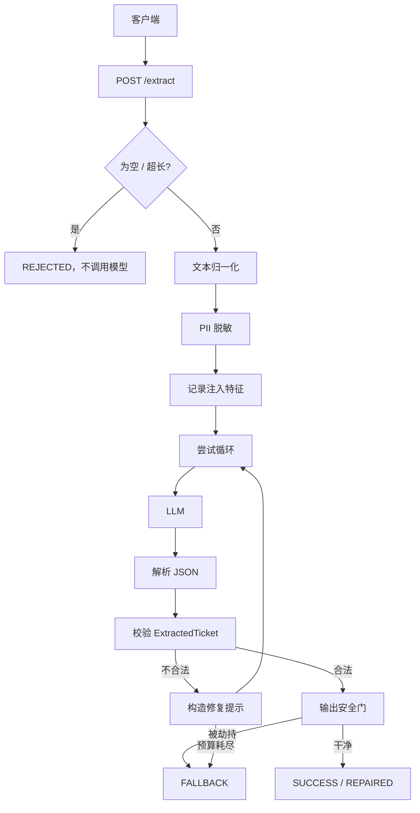
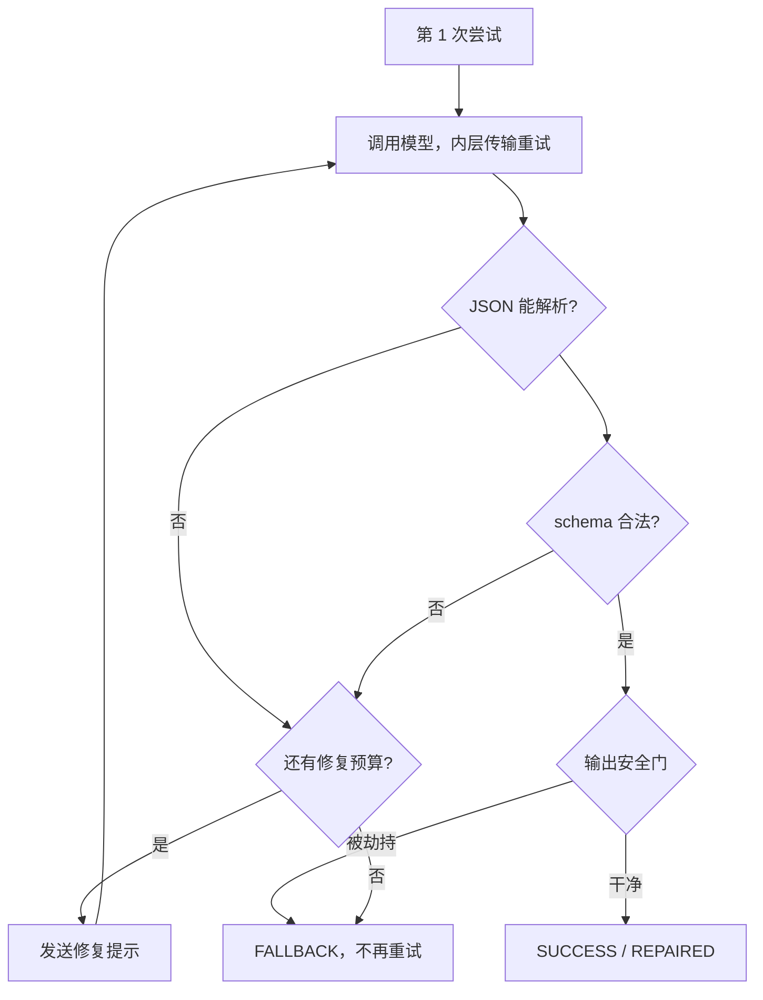
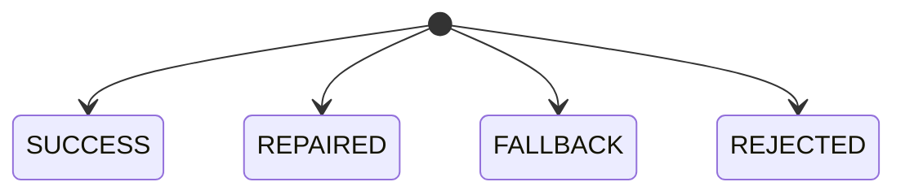
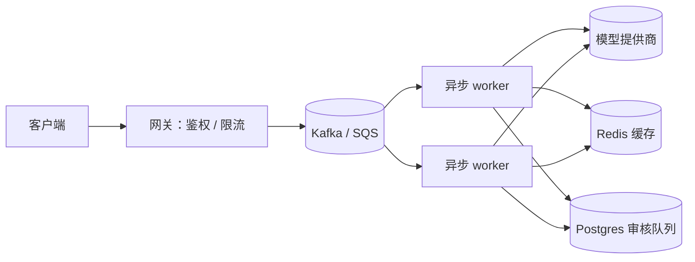

<div align="right">
  <b>简体中文</b> | <a href="README.md">🇺🇸 English</a>
</div>

# 弹性数据提取 Harness

一个小型服务：用 LLM 把原始客服对话转成结构化工单，然后——完全不相信 LLM。

模型是系统里唯一不可控的部分。它周围的一切都是普通代码，行为是固定的：解析、校验、重试、PII 处理、以及你最终拿到的响应。模型给不出合格工单时，请求会被标记转人工，而不是让半截数据流到下游。

- Python 3.10+ · FastAPI · Pydantic v2
- 通过 `OPENAI_BASE_URL` 适配任意 OpenAI 兼容端点（OpenAI / DeepSeek / Qwen / 本地 vLLM）
- 54 个测试，全部离线（模型是脚本化的假桩）

## 快速开始

```bash
python -m venv .venv
# macOS/Linux: source .venv/bin/activate   |   Windows: .venv\Scripts\activate
pip install -r requirements-dev.txt

pytest                          # 54 个测试，无需 API Key
python -m examples.run_demo     # 用假模型跑 4 个基准对话

# 真实服务
export OPENAI_API_KEY=sk-...
uvicorn app.main:app --port 8000
```

除最后一条外，所有命令都不需要 API Key。

## 工作原理

请求按固定阶段推进。模型只在其中某个阶段被调用，它不掌控流程。



### 两套重试预算

把这两者分开，是最核心的设计。

- **传输（内层）：** 429、超时、连接重置在同一次尝试内以有限的短退避重试，不消耗修复预算——网络抖一下，不该花掉一次模型自我纠正。
- **修复（外层）：** 坏 JSON 或 schema 失败，连同上一次输出和具体校验错误一起回喂模型，最多 `MAX_REPAIR_ATTEMPTS` 次。



### 终态

`ExtractionResult` 始终可序列化，调用链上不会有异常抛给调用方。



| 状态 | 含义 |
|---|---|
| `SUCCESS` | 第一次调用即解析并校验通过。 |
| `REPAIRED` | 经过一轮或多轮修复后合法。 |
| `FALLBACK` | 预算耗尽、模型不可达或输出安全门触发。`flagged_for_review=true`。 |
| `REJECTED` | 输入为空或超长，模型从未被调用。不是审核项。 |

## HTTP 接口

```bash
# 提取工单
curl -s localhost:8000/extract \
  -H 'content-type: application/json' \
  -d '{"transcript":"发票 #1001 被重复扣款","transcript_id":"demo-1"}'
```

| 端点 | 作用 |
|---|---|
| `POST /extract` | 跑流水线。请求体 `{"transcript": "...", "transcript_id": "可选"}`，支持 `x-request-id`。 |
| `GET /health` | 进程存活。无外部依赖，可直接给负载均衡器。 |
| `GET /ready` | 配置存在**且**模型可达。用 1 token 的廉价探活，结果缓存 30 秒；失败返回 503 `missing_api_key` 或 `provider_unreachable`。 |

除非设置 `EXPOSE_RAW_LLM_OUTPUTS=true`，否则 HTTP 响应会剥离模型原始文本。

## 作为库使用

同步、异步两个驱动都提供，底层共用同一套流水线代码。

```python
from app.harness import ExtractionHarness, AsyncExtractionHarness
from app.llm_client import OpenAICompatibleClient, AsyncOpenAICompatibleClient

harness = ExtractionHarness(OpenAICompatibleClient(model="gpt-4o-mini"))
result = harness.extract(transcript, transcript_id="tx-1")

async_harness = AsyncExtractionHarness(AsyncOpenAICompatibleClient(model="gpt-4o-mini"))
result = await async_harness.extract(transcript, transcript_id="tx-1")
```

服务端走异步路径；同步驱动留给脚本和离线调用。

## PII 与注入

**脱敏发生在文本被记录或发送给模型之前。**

- 中国居民身份证（18 位，ISO 7064 校验位 + 日期校验）→ `[REDACTED_NATIONAL_ID]`
- 银行卡（Luhn 校验）→ `[REDACTED_CARD]`
- 新加坡 NRIC → `[REDACTED_NRIC]`
- 密码和密钥 → `[REDACTED_PASSWORD]` / `[REDACTED_SECRET]`

卡号、身份证只有通过校验才会被识别，所以发票号、像电话号码的数字串不会被误改。模型若把密钥回显出来，会被再次清洗并强制置 `detected_pii=true`。

**注入防御是分层的，因为单靠任何一层都不靠谱：**

1. 系统提示词明确 transcript 是数据，并内嵌 JSON Schema；
2. 文本用分隔符包裹，若客户输入分隔符就先中性化；
3. 输入扫描记录 `SYSTEM OVERRIDE` 之类的短语；
4. 输出安全门拒绝被劫持的输出，且不把它回灌进修复提示。

安全门处理了一个细节：输入已经像注入时，模型会被指使把 `urgency` 设为 CRITICAL。光有 “critical” 这个词不算证据——攻击者直接打这个词就行。只有当另一个匹配器发现真实业务影响（宕机、全员不可用、支付或发工资受阻、数据泄露）时，CRITICAL 才被接受，否则拒绝。

## 目录结构

```text
app/
├── main.py            # FastAPI 应用（异步）、/health、/ready 探活
├── config.py          # 带校验的环境变量配置
├── schemas.py         # ExtractedTicket + ExtractionResult（契约）
├── harness.py         # 共享流水线 + 同步/异步驱动
├── llm_client.py      # 同步/异步协议 + OpenAI 兼容适配器
├── pii.py             # PII 检测与脱敏
├── injection.py       # 输入扫描 + 输出安全门
├── prompts.py         # 系统提示与修复提示
├── text_norm.py       # NFKC + 零宽/双向字符清理
├── sample_data.py     # 4 个基准对话
├── fakes.py           # 同步/异步脚本化模型桩
└── logging_config.py  # 结构化 JSON 日志

tests/                 # 54 个离线测试
examples/run_demo.py
.github/workflows/ci.yml
```

## 配置

| 变量 | 默认值 | 含义 |
|---|---|---|
| `OPENAI_API_KEY` | – | API Key。 |
| `OPENAI_BASE_URL` | – | 接入 DeepSeek、Qwen、本地 vLLM 等。 |
| `LLM_MODEL` | `gpt-4o-mini` | 模型名。 |
| `LLM_TEMPERATURE` | `0.0` | 采样温度（0–2）。 |
| `LLM_TIMEOUT_S` | `30` | 单次调用超时。 |
| `LLM_MAX_TOKENS` | `1024` | 补全上限。 |
| `LLM_JSON_MODE` | `true` | 发送 `response_format=json_object`，服务器拒绝时关闭。 |
| `MAX_REPAIR_ATTEMPTS` | `2` | 首次调用后的修复轮数。 |
| `MAX_TRANSPORT_RETRIES` | `1` | 一次尝试内的内层重试。 |
| `MAX_TRANSCRIPT_CHARS` | `20000` | 超过则 `REJECTED`。 |
| `BLOCK_ON_INJECTION` | `true` | 输出安全门命中直接返回 `FALLBACK`，不再调用。 |
| `EXPOSE_RAW_LLM_OUTPUTS` | `false` | HTTP 响应是否包含模型原始文本。 |
| `LOG_LEVEL` | `INFO` | 日志级别。 |

非法值启动即报错（如 `MAX_REPAIR_ATTEMPTS` 超出 0–5）。

## 测试

```bash
pytest
```

模型以 `FakeLLMClient` / `AsyncFakeLLMClient` 注入，响应是脚本化列表，因此测试断言的是具体行为：调用次数（安全门触发时恰好 1 次，预算耗尽时恰好 3 次）、修复提示里的错误文本、兜底信封始终可序列化。同时有反向用例防止防护悄悄变得过激：过不了 Luhn 的数字串不脱敏，合法的 CRITICAL 工单不被拒。

## 扩展到 10,000 ops/min

10k/min ≈ 170 RPS。Harness 自身每请求开销很小（一次正则扫描、最多 3 次模型调用、校验），瓶颈是模型往返。

同步路由会在整个请求期间占住 Starlette 40 个工作线程之一。按平均 3 秒算，170 RPS 大约需要 `170 × 3 ≈ 510` 个线程——是默认线程池的 13 倍。所以服务走异步：等待模型时事件循环空闲，少量 worker 就能承载几百个在途请求。



已经具备：异步 I/O、缓存就绪探活、日志里的单次与总延迟、有界的输入和预算。真正生产部署还需要：背压队列、以脱敏 transcript 哈希为键的结果缓存、上游挂掉时的熔断器、OpenTelemetry 链路、网关层的每租户限流。注意默认预算下最坏情况要等 `3 次尝试 × 2 次传输 × 30 秒 ≈ 180 秒`——合理的做法是给 HTTP 加截止时间（如 15 秒），把请求放进队列。

## 权衡与缺口

- 用 Pydantic v2 而不是 TS/Zod：技术栈偏 Python，且能直接拿到 `model_json_schema()` 放进提示词，校验也快。
- 用正则而不是 NER 做 PII：确定、免费、覆盖点名的标识符足够；它封装在一个小函数后，可以替换。
- 软字段从宽：超长摘要截断、空步骤丢弃，而不是消耗一轮修复；硬完整性规则（枚举、类型）仍然失败。
- 修复上限两轮：再往后成本和延迟涨得比成功率快。
- 时间盒内没做（刻意）：熔断器、队列、缓存、鉴权、指标后端。这些写在上面，而不是做一半。
